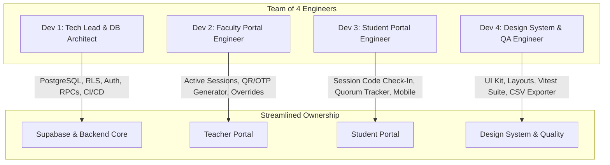

# AttendX — Engineering & Team Collaboration Workflow

This document outlines the collaborative engineering workflow for the **team of 4** developing **AttendX**, ensuring strict adherence to the AttendX Engineering Principles.

---

## 1. Team Division & Task Ownership



### Role Breakdown:
- **Developer 1 (Tech Lead / Core)**:
  - Repository structure, CI GitHub Actions, Supabase migrations, Row-Level Security (RLS) policies.
  - Reviews backend/auth PRs. Ensures no service-role keys touch client code.
- **Developer 2 (Teacher Portal Specialist)**:
  - Faculty dashboard, dynamic attendance session creation, real-time attendee monitoring.
  - Manual verification override controls.
- **Developer 3 (Student Portal Specialist)**:
  - Student dashboard, token check-in terminal with Zod validation.
  - Quorum percentage calculations and attendance warning indicators (<75%).
- **Developer 4 (Design System & QA Lead)**:
  - Reusable component primitives (Buttons, Cards, Modals, Badges, Tables).
  - Accessibility (ARIA, keyboard navigation), responsive breakpoints, and Vitest test coverage.

---

## 2. Milestone Roadmap

| Milestone | Scope | Deliverables | Owner |
| :--- | :--- | :--- | :--- |
| **Milestone 1** (Current) | **Frontend Foundation & Scaffold** | Responsive Teacher & Student layout prototypes, mock data clearly tagged, Zod validation, Vitest setup, GitHub CI | Entire Team |
| **Milestone 2** | **Supabase Auth & RLS** | Supabase login with role distinction (`faculty` vs `student`), PostgreSQL profiles trigger, RLS policies active | Dev 1 & Dev 4 |
| **Milestone 3** | **Faculty Session Engine** | Session generation, dynamic code rotation, live student list via Supabase Realtime subscriptions | Dev 2 & Dev 1 |
| **Milestone 4** | **Student Check-In & Verification** | Student token submission connected to PostgreSQL RPC `submit_student_attendance`, real-time quorum calculation | Dev 3 & Dev 4 |
| **Milestone 5** | **Auditing, Exports & Hardening** | Manual overrides by faculty, CSV export, edge case test suites, threshold email/in-app warnings | All Devs |

> [!IMPORTANT]
> **Engineering Rule 1 & 14:** Before starting each milestone, explain the plan. Never silently proceed to authentication, database writes, or deployment while working on the current milestone.

---

## 3. Git Branching & PR Strategy

### Branch Strategy
- `main`: Always deployable and verified. Protected branch.
- `develop`: Integration branch for completed milestones.
- Feature branches naming:
  - `feat/teacher-session-runner`
  - `feat/student-checkin-terminal`
  - `feat/supabase-rls-schema`
  - `fix/attendance-threshold-calc`

### Pull Request & Review Checklist
1. Every PR requires **at least 1 peer review approval** before merging into `develop`.
2. PR descriptions must follow `.github/pull_request_template.md`.
3. CI Actions must pass:
   - TypeScript strict mode check (`npm run build`).
   - Vitest unit tests (`npm run test`).
4. **No Direct Commits to `main` or `develop`.**

---

## 4. Supabase Database & Security Protocol

- **Local Migrations:** Never edit database tables directly in the Supabase dashboard in production. Always write SQL files in `supabase/migrations/` and track them in Git.
- **Server-Side Enforcement (Rule 9 & 10):**
  - All sensitive actions (e.g. marking attendance, overriding status, creating sessions) run through PostgreSQL RLS or `SECURITY DEFINER` stored procedures.
  - Frontend checks are for UX only; database constraints are the source of truth.
- **Client Secrets (Rule 7 & 8):**
  - Only `VITE_SUPABASE_URL` and `VITE_SUPABASE_ANON_KEY` are allowed in `.env.local`.
  - The `service_role` key must NEVER be referenced anywhere in `src/`.

---

## 5. Instructions for Creating & Linking the GitHub Repository

To push this codebase to GitHub:

### Option A: Using GitHub Web UI
1. Go to [github.com/new](https://github.com/new).
2. Name the repository `attendx`.
3. Set visibility to **Private** or **Public**.
4. Do **NOT** initialize with a README, .gitignore, or license (these are already created).
5. Open your terminal in your Desktop folder and run:
```bash
cd "$env:USERPROFILE\OneDrive\Desktop\attendx"
# or in Git Bash: cd "/c/Users/HP/OneDrive/Desktop/attendx"
git init
git add .
git commit -m "feat: initial AttendX foundation with dual dashboards and team workflow"
git branch -M main
git remote add origin https://github.com/YOUR_GITHUB_USERNAME_OR_ORG/attendx.git
git push -u origin main
```

### Option B: Using GitHub CLI (`gh`)
If you have `gh` installed and authenticated on your system:
```bash
cd "$env:USERPROFILE\OneDrive\Desktop\attendx"
git init
git add .
git commit -m "feat: initial AttendX foundation with dual dashboards and team workflow"
gh repo create attendx --public --source=. --remote=origin --push
```

### Adding Your 3 Teammates
Once the repository is pushed:
1. Navigate to your repository on GitHub.
2. Go to **Settings** > **Collaborators** > **Add people**.
3. Add your teammates' GitHub usernames.
4. Set up branch protection rules for `main` and `develop` requiring pull request reviews before merging.
